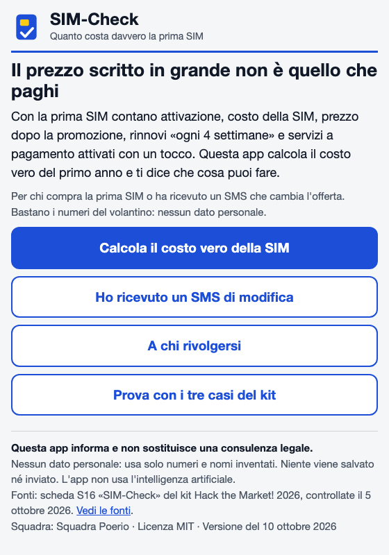

# sim-check
A single-file web page that adds up what the first year of a SIM offer really costs: activation fee, renewals every 4 weeks and the price after the promo.
It also reads a plan-change SMS and works out the notice days, the increase and the last day to cancel without penalty, and it prepares text you can copy for a complaint or a cancellation.
The rules and the test cases come from the kit of Hack the Market! 2026 (Prosumer APS, Salerno), checked on 5 October 2026.
It runs offline, stores and sends nothing, and does not use AI. It is not legal advice.

How to use it: download index.html from this repository and open it in your browser. Everything is in that one file.
Written with AI help, reviewed by the author.

Code: MIT. Texts of the rules and cases: from the Prosumer kit, CC BY-SA 4.0.
